# Phase B: the full game

## Playtest changes from Phase A

1. **Harder runs between decision points.** New hazards are introduced one world at a time and reused afterwards:
   beetles, thorns, low logs and stumps (Spring Meadow), bees (Deep Forest: hovering at head height — duck — or low —
   jump), spiky snails (Mushroom Valley: jump over, no stomping), rolling acorns (Autumn Woods: they start rolling
   towards you once on screen), everything together in the Misty Swamp. Levels 1-3 of each world stay gentle and
   teach one thing with a sign; levels 4-12 get more hazards, tighter spacing (down to ~0.75 s between hazards) and
   back-to-back combinations.
2. **Speed.** Each level starts a little faster than the one before (+0.6 % per level, +5 % per world) and speeds up
   at every checkpoint flower (+5 %; +2 % in the teaching levels). The cap is 1.5x level 1 (6.9 units/s). Decision
   points are still a full stop, and the plant crossings always run at the level-1 speed, so a plant's result never
   depends on the speed.
3. **Fairness.** The camera always shows `viewAhead(speed) = 1.2 s × speed + 2 units` ahead of the sprite (it zooms
   out a little as the speed grows), and the level validator measures every hazard of every level in the bot's real
   run: each one is on screen at least 1 s before the sprite reaches it (the closest is 1.07 s, a rolling acorn at
   top speed). The validator also requires each level to be beaten at its real speed with all 3 golden acorns,
   without needing more than the level's 3 hearts and its seeds. See [../levels-report.md](../levels-report.md).
4. **Curve.** Teaching levels first in every world, then the harder hazard and speed settings.

## Screens

| | | |
| --- | --- | --- |
| 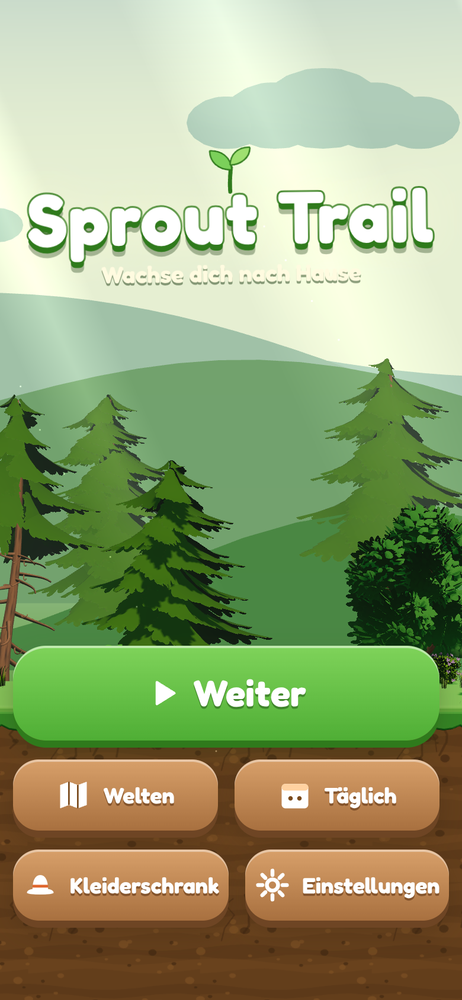 | 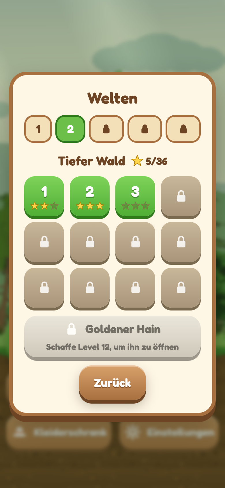 | 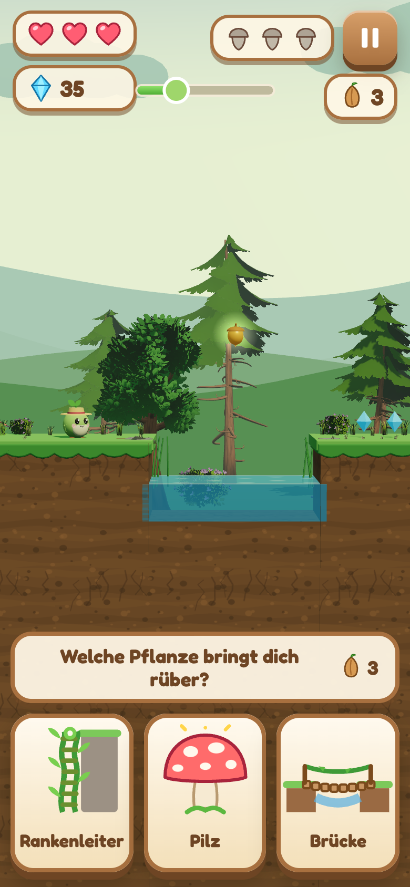 |
| 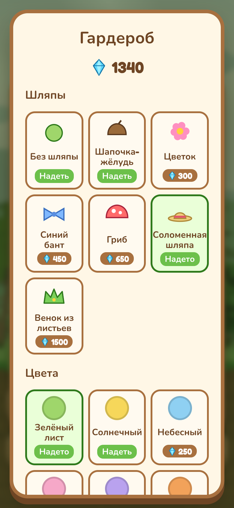 | 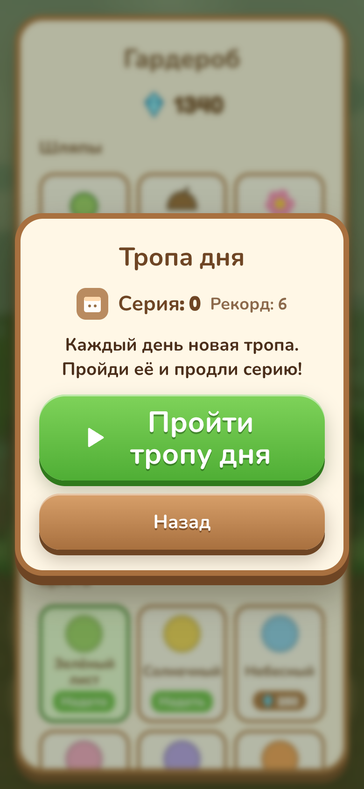 | 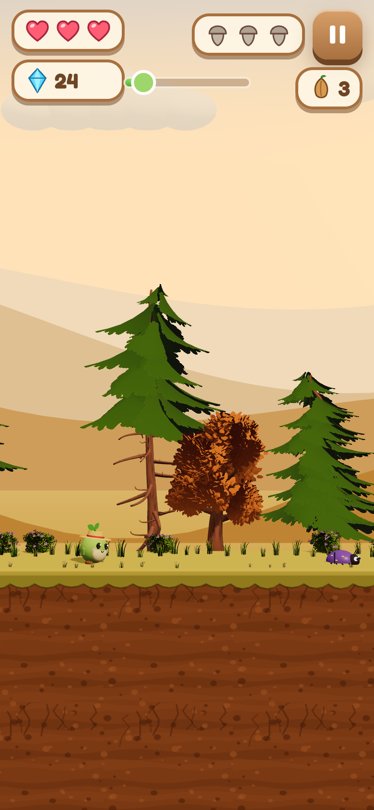 |

| | |
| --- | --- |
| 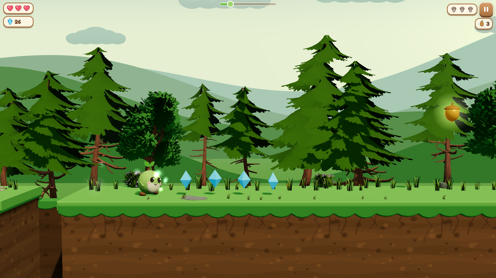 | 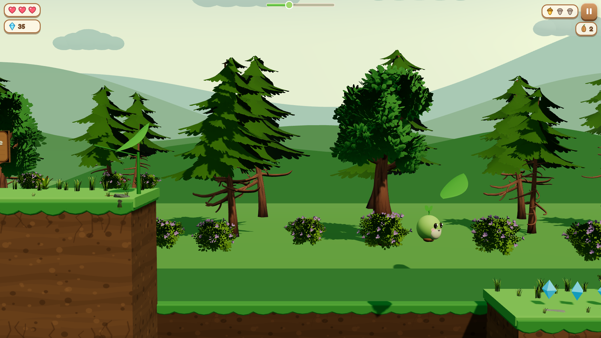 |
| 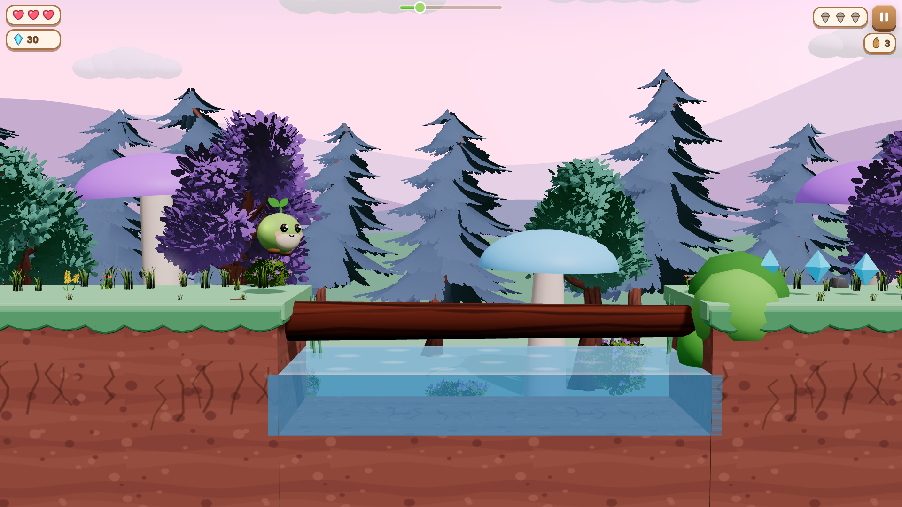 | 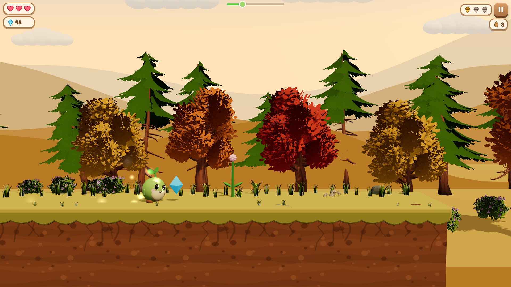 |
| 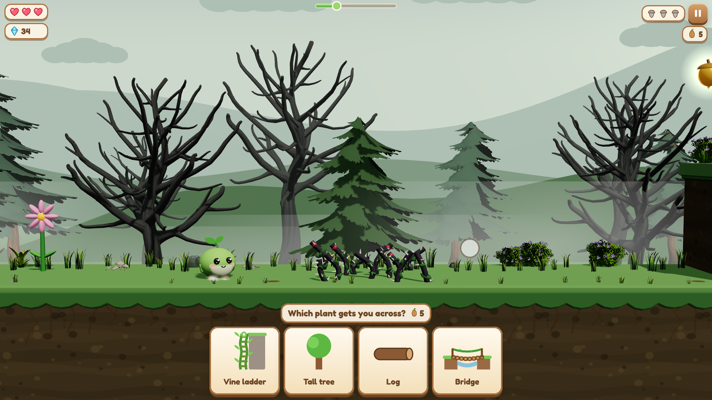 | |

Phone shots: 390x844 at 2x, German and Russian (the longest texts); the e2e tests check that no text overflows its
button, card or panel at 390x844 and 1280x720 in German, Russian and French.

## CrazyGames quality checklist

| Guideline | How |
| --- | --- |
| In level 1 within 5 s | the first level is already loaded behind the title; Play starts it at once (no loading screen between) |
| Tutorial inside gameplay | wooden signs + animated hand with one short line, one idea per level |
| Clear goal always visible | hearts, gems, golden acorns, seeds and a progress bar in the HUD |
| Big labelled menu buttons | Play / Continue, Worlds, Daily, Wardrobe, Settings |
| Settings | music, sound effects, language (6), reset progress with confirmation |
| In-game pause | pause button (and automatic pause when the tab is hidden) |
| Languages | en, fr, de, es, it, ru — one JSON each, from the platform locale, switchable; CI checks missing keys |
| Ads | rewarded only from labelled buttons with a TV icon (+2 seeds, continue with 1 heart, double gems), reward only on completion, 8 s timeout + "No ad available right now, try later" for 2.5 s; interstitials only between levels, at most one per 2 minutes; none in the web build |
| Saves | CrazyGames Data Module (SDK v3) |
| Size / load | about 2.3 MB per build, a loading screen with a progress bar |
