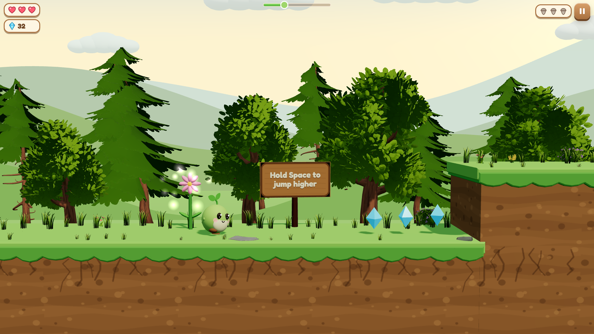
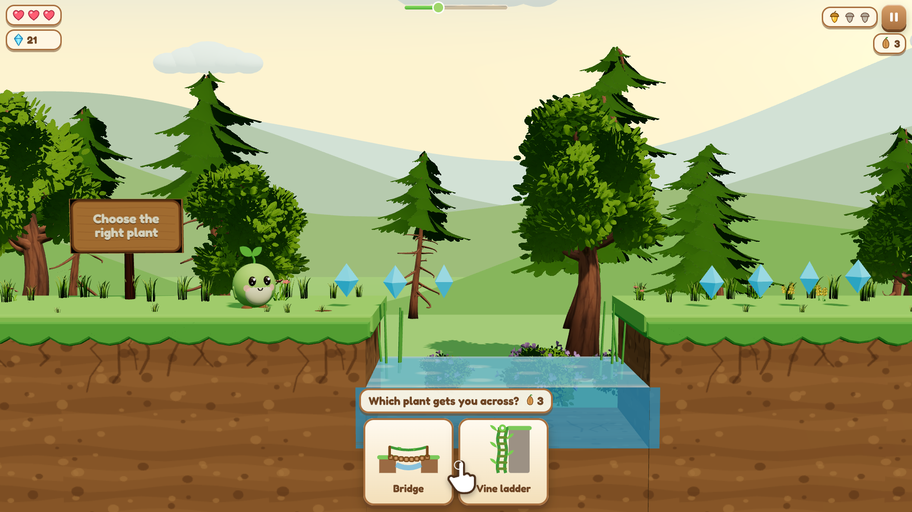
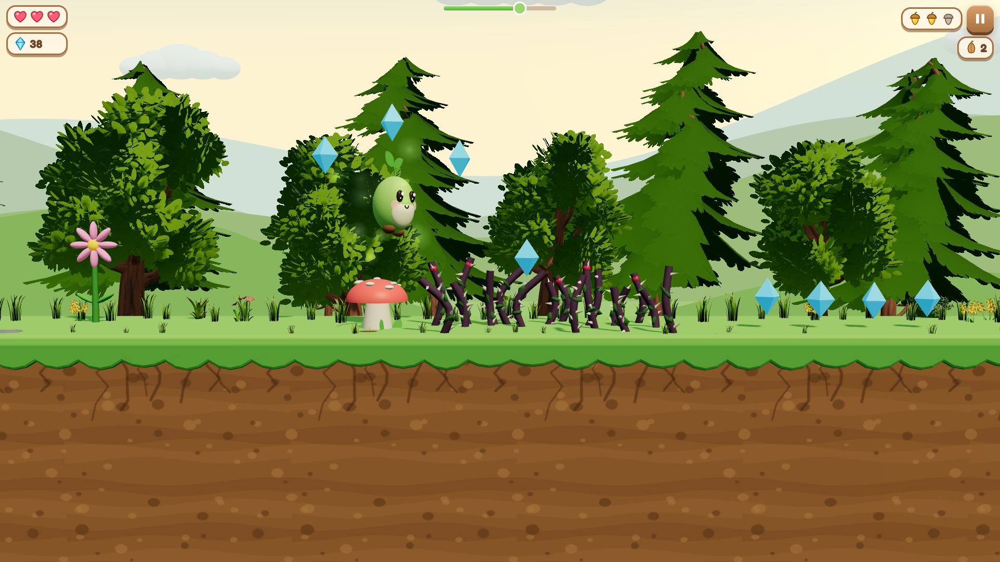
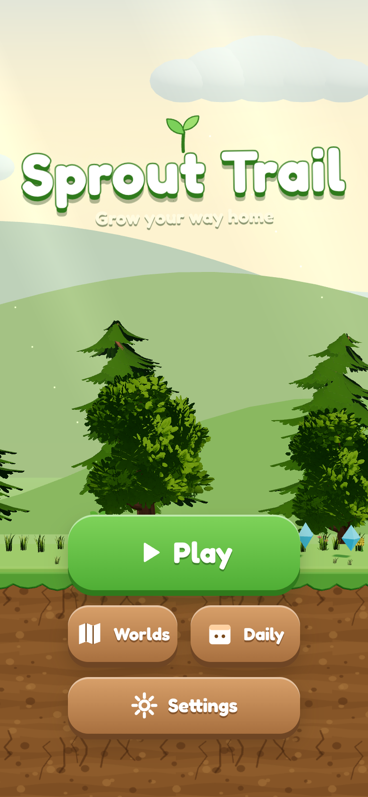
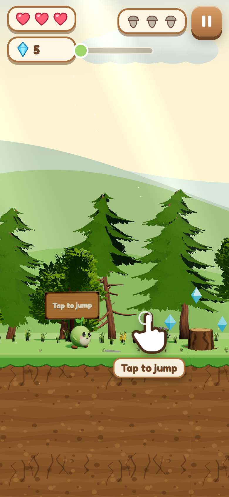
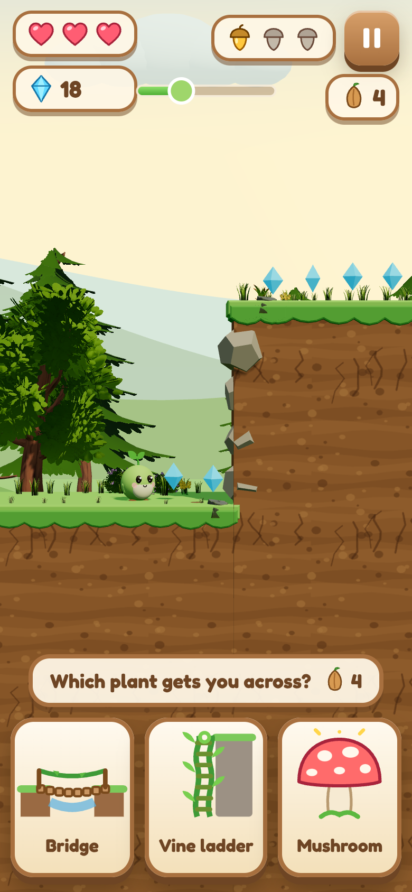

# Phase A preview

Spring Meadow, levels 1-3, the forest sprite, one-finger controls, sound and music.

- **1-1** teaches jumping (tap, hold to jump higher) and ducking (swipe down) with wooden signs and an animated hand.
- **1-2** is the first decision point: a stream too wide to jump — the bridge crosses, the vine ladder splashes.
- **1-3** has two decision points: a high wall (vine ladder; the bridge and mushroom bonk) and a thorn field
  (mushroom; the bridge's planks get poked through, the vine drops you into the thorns), plus the first beetles.

| | |
| --- | --- |
|  |  |
|  | |

| | | |
| --- | --- | --- |
|  |  |  |

Video (390x844, 30 s, all 3 levels, including a wrong seed choice): [sprout-trail-3-levels-390x844.mp4](sprout-trail-3-levels-390x844.mp4)

Desktop shots are 1920x1080; phone shots are a 390x844 viewport rendered at 2x. All are captured from real play by
`scripts/preview-shots.ts` / `scripts/preview-video.ts`: the level bot drives the game through its input path in a
headless browser with software WebGL (no GPU, so shadows and antialiasing are a little softer than on a real device).
The video is cut to the key moments of each level and sped up slightly to fit 30 s.
